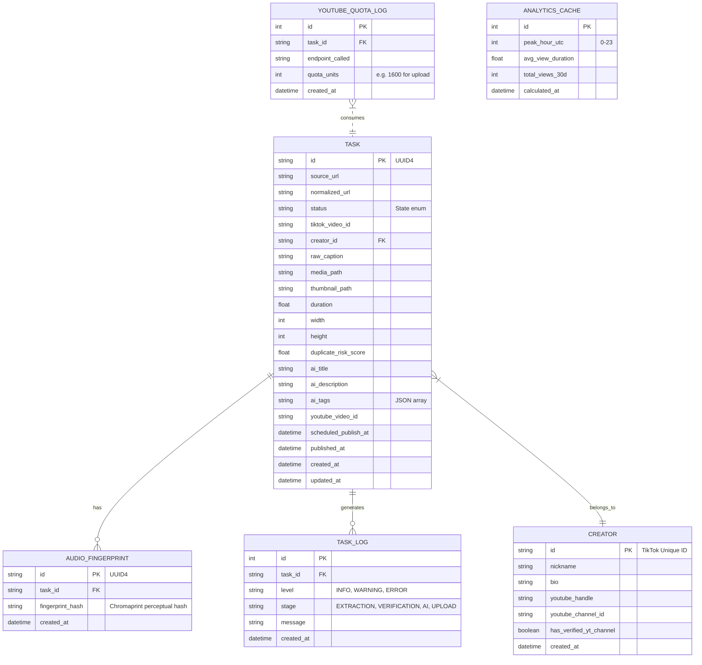
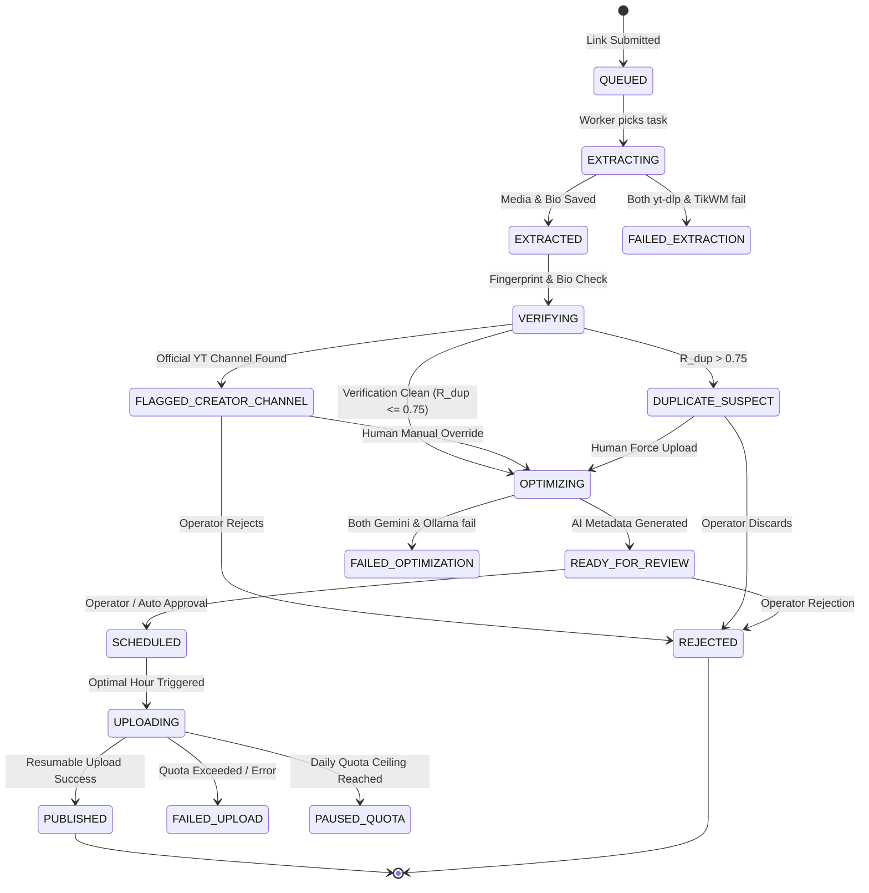

# AutoShorts: Database Schema & State Machine Specification

## 1. Storage Engine Architecture

The persistence layer runs on **SQLite 3** operating in **Write-Ahead Logging (WAL)** mode. WAL mode enables concurrent read transactions while write operations execute, eliminating `database is locked` errors under concurrent FastAPI and Celery worker workloads.

### WAL Mode Engine Configuration
Every database connection executes the following PRAGMAs upon initialization:
```sql
PRAGMA journal_mode = WAL;
PRAGMA synchronous = NORMAL;
PRAGMA busy_timeout = 5000;
PRAGMA foreign_keys = ON;
PRAGMA cache_size = -64000; -- 64MB cache
```

---

## 2. Entity-Relationship Diagram



---

## 3. Task State Machine Transitions



---

## 4. SQL Table Definitions

### 4.1 `tasks` Table
```sql
CREATE TABLE tasks (
    id TEXT PRIMARY KEY,
    source_url TEXT NOT NULL,
    normalized_url TEXT NOT NULL,
    status TEXT NOT NULL DEFAULT 'QUEUED',
    tiktok_video_id TEXT,
    creator_id TEXT,
    raw_caption TEXT,
    media_path TEXT,
    thumbnail_path TEXT,
    duration REAL,
    width INTEGER,
    height INTEGER,
    duplicate_risk_score REAL DEFAULT 0.0,
    ai_title TEXT,
    ai_description TEXT,
    ai_tags TEXT, -- JSON array of strings
    youtube_video_id TEXT,
    scheduled_publish_at TIMESTAMP,
    published_at TIMESTAMP,
    error_message TEXT,
    created_at TIMESTAMP DEFAULT CURRENT_TIMESTAMP,
    updated_at TIMESTAMP DEFAULT CURRENT_TIMESTAMP,
    FOREIGN KEY (creator_id) REFERENCES creators(id)
);

CREATE INDEX idx_tasks_status ON tasks(status);
CREATE INDEX idx_tasks_scheduled ON tasks(scheduled_publish_at);
CREATE INDEX idx_tasks_created_at ON tasks(created_at);
```

### 4.2 `creators` Table
```sql
CREATE TABLE creators (
    id TEXT PRIMARY KEY, -- tiktok unique_id
    nickname TEXT,
    bio TEXT,
    youtube_handle TEXT,
    youtube_channel_id TEXT,
    has_verified_yt_channel BOOLEAN DEFAULT 0,
    created_at TIMESTAMP DEFAULT CURRENT_TIMESTAMP
);

CREATE INDEX idx_creators_yt_handle ON creators(youtube_handle);
```

### 4.3 `audio_fingerprints` Table
```sql
CREATE TABLE audio_fingerprints (
    id TEXT PRIMARY KEY,
    task_id TEXT NOT NULL,
    fingerprint_hash TEXT NOT NULL,
    created_at TIMESTAMP DEFAULT CURRENT_TIMESTAMP,
    FOREIGN KEY (task_id) REFERENCES tasks(id) ON DELETE CASCADE
);

CREATE INDEX idx_fingerprints_task_id ON audio_fingerprints(task_id);
```

### 4.4 `youtube_quota_log` Table
```sql
CREATE TABLE youtube_quota_log (
    id INTEGER PRIMARY KEY AUTOINCREMENT,
    task_id TEXT,
    endpoint_called TEXT NOT NULL,
    quota_units INTEGER NOT NULL,
    created_at TIMESTAMP DEFAULT CURRENT_TIMESTAMP,
    FOREIGN KEY (task_id) REFERENCES tasks(id)
);

CREATE INDEX idx_quota_created_at ON youtube_quota_log(created_at);
```

### 4.5 `analytics_cache` Table
```sql
CREATE TABLE analytics_cache (
    id INTEGER PRIMARY KEY AUTOINCREMENT,
    peak_hour_utc INTEGER NOT NULL DEFAULT 15,
    avg_view_duration REAL DEFAULT 0.0,
    total_views_30d INTEGER DEFAULT 0,
    calculated_at TIMESTAMP DEFAULT CURRENT_TIMESTAMP
);
```

### 4.6 `task_logs` Table
```sql
CREATE TABLE task_logs (
    id INTEGER PRIMARY KEY AUTOINCREMENT,
    task_id TEXT NOT NULL,
    level TEXT NOT NULL DEFAULT 'INFO',
    stage TEXT NOT NULL,
    message TEXT NOT NULL,
    created_at TIMESTAMP DEFAULT CURRENT_TIMESTAMP,
    FOREIGN KEY (task_id) REFERENCES tasks(id) ON DELETE CASCADE
);

CREATE INDEX idx_task_logs_task_id ON task_logs(task_id);
```

