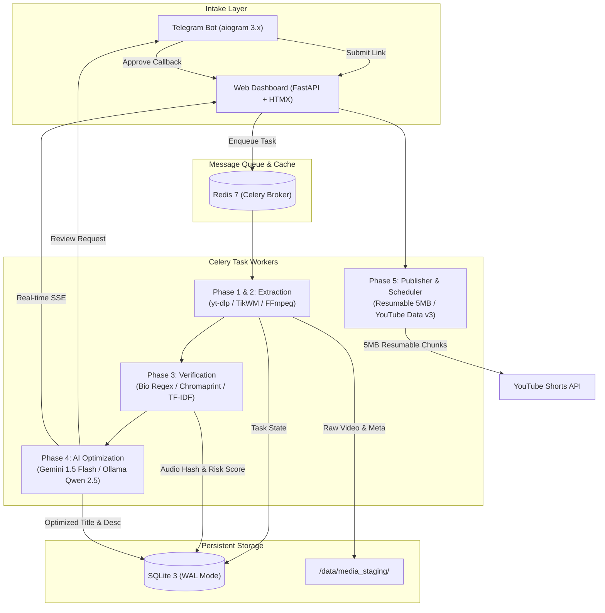

# AutoShorts: System Architecture Specification

## 1. High-Level Architecture Overview

**AutoShorts** is an automated cross-platform video curation, deduplication, metadata enhancement, and distribution engine. It takes vertical video links from TikTok, extracts watermark-free high-definition streams, performs intellectual property and deduplication audits, optimizes metadata via LLM/SLM engines, and strategically publishes videos as YouTube Shorts.

---

## 2. Hardware Resource Budgeting (ARM64 & Local Docker)

Target Environment: Oracle Cloud Always Free ARM Ampere A1 (4 OCPUs, 24 GB RAM) or Local Docker Host.

| Container / Service | Image Base | OCPU Limit | RAM Limit | Purpose |
| :--- | :--- | :--- | :--- | :--- |
| `redis` | `redis:7-alpine` | 0.2 OCPU | 256 MB | Message broker, concurrency locks, SSE channel |
| `ollama` | `ollama/ollama:latest` | 2.0 OCPU | 3000 MB | Local SLM inference (`qwen2.5:3b` Q4_K_M) |
| `web` | Python 3.11 Slim | 0.5 OCPU | 512 MB | FastAPI app, HTMX dashboard, SSE telemetry |
| `celery_worker` | Python 3.11 Slim + FFmpeg | 1.5 OCPU | 2000 MB | Extraction, Chromaprint, FFmpeg, YouTube upload |
| `telegram_bot` | Python 3.11 Slim | 0.2 OCPU | 256 MB | Asynchronous intake & inline keyboard review |
| **Total Allocation** | | **4.4 OCPU** | **~6.0 GB RAM** | **Well within 24 GB budget** |

---

## 3. Subsystem Architectural Details

### 3.1 Subsystem 1: Media Extraction & Codec Normalization
- **Primary Tool**: `yt-dlp` using `--format "bv*[vcodec^=avc]+ba/b"`.
- **Secondary Tool**: TikWM REST API (`https://www.tikwm.com/api/` with `hd=1`).
- **Codec Enforcement**:
  - Resolution: 1080 x 1920 (9:16 vertical aspect ratio).
  - Video Codec: H.264 (libx264, profile high, level 4.2).
  - Audio Codec: AAC (128 kbps, 44.1 kHz / 48 kHz stereo).
  - Filter: `scale=1080:1920:force_original_aspect_ratio=decrease,pad=1080:1920:(ow-iw)/2:(oh-ih)/2`.

### 3.2 Subsystem 2: Deduplication & Creator Rights Engine
- **Bio Regex Patterns**:
  - `youtube\.com/@([a-zA-Z0-9_\-\.]{3,30})`
  - `youtube\.com/channel/([a-zA-Z0-9_\-]{24})`
  - `(?:yt|youtube):\s*@?([a-zA-Z0-9_\-\.]{3,30})`
- **Acoustic Hashing**:
  - Extract 16kHz mono WAV via FFmpeg.
  - Compute Chromaprint audio fingerprint using `pyacoustid`.
  - Calculate Hamming bit-distance against previously stored fingerprints.
- **Caption Vector Proximity**:
  - TF-IDF Cosine Similarity ($S_{cos}$) using `scikit-learn`.
  - Normalized Levenshtein Edit Distance ($L_{norm}$).
- **Composite Formula**:
  $$R_{dup} = 0.50 \cdot \text{Match}_{audio} + 0.30 \cdot S_{cos} + 0.20 \cdot L_{norm}$$
  - $R_{dup} > 0.75$: Flagged as `DUPLICATE_SUSPECT`. Requires manual operator confirmation.

### 3.3 Subsystem 3: Dual-Engine AI Metadata Optimization
- **Primary Engine**: Google Gemini 1.5 Flash Free API.
  - JSON schema enforcement via `response_mime_type="application/json"`.
  - System prompt enforces: Title < 60 chars, 2 contextual description sentences + creator attribution, exactly 3 tags, zero hashtags in title.
- **Secondary Engine**: Local Ollama running `qwen2.5:3b`.
  - Activated if Gemini returns HTTP 429, 500, or network timeout (> 8.0s).

### 3.4 Subsystem 4: YouTube Resumable Publisher & Analytics Scheduler
- **Daily Quota Ceiling**: YouTube Data API v3 enforces a 10,000 units/day quota.
  - Video upload = 1,600 units.
  - Max automated uploads = 5-6 per 24-hour cycle.
  - If quota balance < 1,600 units, publishing is halted until 00:00 PST.
- **Dynamic Scheduling**:
  - Queries YouTube Analytics API `reports.query` over past 30 days.
  - Computes peak hourly viewership for vertical Shorts traffic.
  - Schedules publication using `publishAt` parameter.
- **Resumable Chunk Streaming**:
  - Uploads in 5 MB (`5,242,880` bytes) binary chunks.
  - Exponential backoff algorithm: Retries HTTP 500, 502, 503, 504 status codes up to 5 times.

---

## 4. Failure Recovery Matrix

| Failure Mode | Detection Vector | Automated Recovery Action |
| :--- | :--- | :--- |
| **TikTok IP Rate Limit / 403** | Subprocess exit code != 0 | Switch immediately to TikWM REST client |
| **Gemini 429 Rate Limit** | HTTP 429 status code | Route generation request to local Ollama instance |
| **YouTube Quota Exhausted** | HTTP 403 `quotaExceeded` | Freeze publishing queue until 00:00 PST reset |
| **Worker OOM / Memory Leak** | Container healthcheck failure | Docker `restart: unless-stopped`, worker pool recycled |
| **OAuth Token Invalidated** | `invalid_grant` response | Telegram emergency alert sent with re-auth link |
| **Network Interruption during Upload** | Socket timeout / HTTP 5xx | Resume upload from last verified byte range offset |

